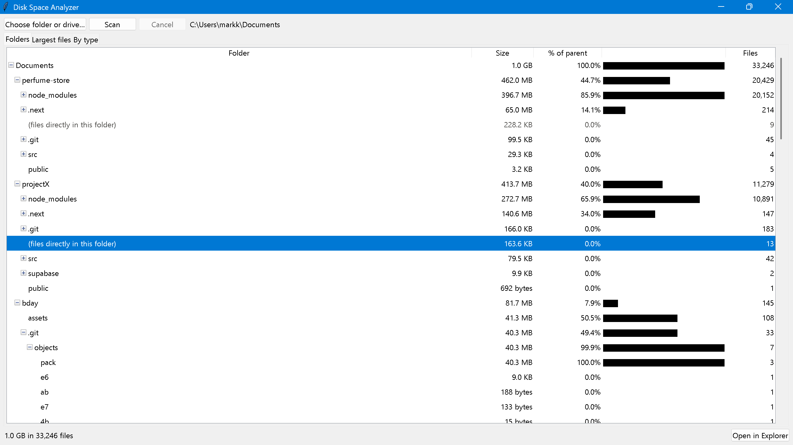
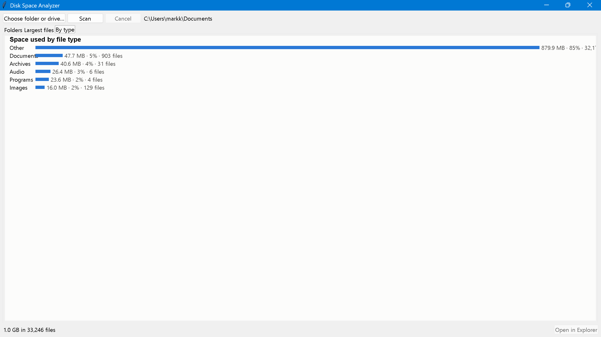
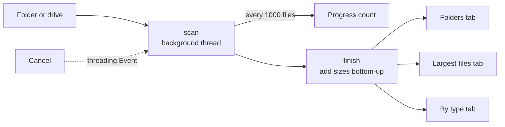

# Disk Space Analyzer

A Windows desktop app that shows what's taking up space: the biggest folders,
the largest files, and totals by file type. It's **read-only**: it never
moves, renames or deletes anything, so it's safe to point at a whole drive.

**Folders**: biggest first, expandable:



**By type**: space used by each kind of file:



## Features

- **Scan any folder or a whole drive** (e.g. `C:\`)
- **Folders tab**: every folder's total size, % of its parent and a bar, biggest first; expand to drill down
- **Largest files tab**: the top 100 files and where they are
- **By type tab**: a bar chart of space used by Videos, Images, Documents, Audio, Archives, Programs and Other
- **Open in Explorer** (or double-click) to jump to any folder or file
- **Live progress and Cancel**: the window never freezes; a cancelled scan still shows partial results
- **Single `.exe`**: no Python needed

## How it stays accurate

| Problem | How it's handled |
|---|---|
| Windows has hidden links (junctions) such as `Application Data` that point back to a parent folder; following them counts files twice or loops forever | Links and junctions are never followed |
| OneDrive "online-only" files report their full size but use no disk space | Counted separately and shown in the status line, not added to any total |
| Folders you don't have permission to open (common on `C:\`) | Counted and reported, not an error |
| Files that disappear or lock mid-scan | Skipped quietly |
| Very deep folder trees | No recursion, so depth can't crash the scan |

## How it works



1. **One pass, no recursion**: `scan()` keeps a "to visit" list of folders instead of calling itself. Each file's size is added to its own folder, its file-type total and, if it's big enough, the largest-files list.
2. **Largest files with a heap**: only the top 100 are kept (a min-heap: the smallest of the top 100 sits on top and is replaced when a bigger file appears), so memory stays small even across millions of files.
3. **Bottom-up totals**: every folder is recorded before its subfolders, so walking that list backwards adds each finished folder's total to its parent in one pass.
4. **Background scanning**: the scan runs on its own thread and reports progress; the window checks every 150 ms. Cancel sets a `threading.Event` the scan checks between files.
5. **Lazy tree**: subfolders are only added to the Folders view when you expand a folder, so even a whole drive displays instantly.

`analyzer.py` has no UI code, so all of this is tested without a window.

## Tech stack

- Python 3.11+
- Tkinter (built into Python) for the window and chart
- `os.scandir`, `heapq` and `threading` from the standard library
- pytest for tests
- PyInstaller to build the `.exe`

No third-party packages are needed to run it.

## Project structure

```
disk-space-analyzer/
  app.py            # the window: tabs, chart, progress, cancel (no logic)
  analyzer.py       # all the logic: scan, totals, largest files, by type
  tests/            # 13 tests, all run on temporary folders
  docs/screenshots/
  requirements.txt
  LICENSE
```

## Setup

### Just use it
Download `DiskSpaceAnalyzer.exe` from the [Releases](../../releases) page and double-click it.

> Windows SmartScreen may warn that the app is unrecognised, because it isn't code-signed. Click **More info**, then **Run anyway**.

### Run from source (PowerShell)
```powershell
git clone https://github.com/nexusknox/disk-space-analyzer.git
cd disk-space-analyzer
python -m venv .venv
.\.venv\Scripts\Activate.ps1
pip install -r requirements.txt
python app.py
```

Run the tests:
```powershell
pytest
```

Build the `.exe`:
```powershell
pip install pyinstaller
pyinstaller --onefile --windowed --name DiskSpaceAnalyzer app.py
```

## Limitations

- **Sizes are file sizes, not space on disk**: compressed files and the drive's allocation units can make real usage slightly different
- **Without admin rights**, some system folders on `C:\` can't be opened and are left out (the app tells you how many)
- **Hard links** (the same file in two places) are counted twice
- Files are only shown, never deleted; to free space, use Open in Explorer and delete from there
- Windows only for real use; tested manually on Windows 11; the `.exe` isn't code-signed

## Future improvements

- Treemap view (rectangles sized by space used)
- Compare two scans to see what grew
- Filter the largest files by type or age
- Export results to CSV

## License

MIT, see [LICENSE](LICENSE).